# PandaCode

A small, native desktop workspace for coding agents. PandaCode runs the coding
CLIs you already use — **Claude Code, Codex, Kimi Code, OpenCode, GLM Coding
Plan, Xiaomi MiMo and Alibaba Token Plan** (through Claude Code), **GitHub Copilot CLI, Antigravity,
xAI's Grok Build, DeepSeek, Command Code, Cline, Kilo Code, Devin CLI and Hermes Agent** (through ACP), **ZCode** (through its app-server protocol), **Pi** and its
fork **omp** (through Pi's RPC mode), and Meta's **Muse Code** (through its MSP
protocol) — side by side, with your projects, Git, a
terminal and a browser in one window.

PandaCode is free and open source under the [PandaCode License](LICENSE), the MIT
License with one addition: forks that are used commercially or released publicly
must say "This is a fork of PandaCode" and link to this repository. There is no
account, no license key and no telemetry.

Built with Tauri 2, Rust, SQLite and plain TypeScript. It uses the operating
system's webview: no bundled Chromium, resident Node server, React runtime or
embedded editor engine.

<p align="center">
  <b>Download:</b>
  <a href="https://github.com/aicodeking/pandacode/releases/latest/download/PandaCode-macOS-arm64.dmg">macOS (Apple silicon)</a> ·
  <a href="https://github.com/aicodeking/pandacode/releases/latest/download/PandaCode-macOS-x64.dmg">macOS (Intel)</a> ·
  <a href="https://github.com/aicodeking/pandacode/releases/latest/download/PandaCode-Windows-x64-setup.exe">Windows x64</a> ·
  <a href="https://github.com/aicodeking/pandacode/releases/latest/download/PandaCode-Windows-arm64-setup.exe">Windows arm64</a> ·
  <a href="https://github.com/aicodeking/pandacode/releases/latest/download/PandaCode-Linux-x86_64.AppImage">Linux x64</a> ·
  <a href="https://github.com/aicodeking/pandacode/releases/latest/download/PandaCode-Linux-aarch64.AppImage">Linux arm64</a> ·
  <a href="https://github.com/aicodeking/pandacode/releases">All releases</a> ·
  <a href="https://testflight.apple.com/join/TpY9PjJe">iPhone (TestFlight)</a>
</p>

<p align="center">
  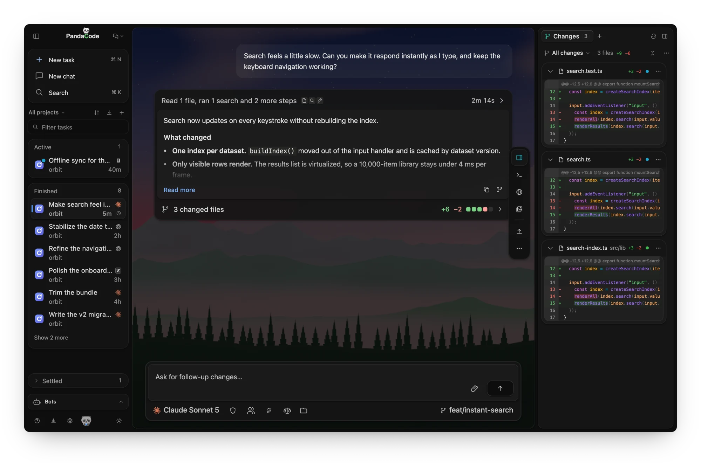
</p>

## Features

### The interface

- **A live scene in every thread.** The conversation is a window onto one of eight
  procedural scenes (sky, alpine, aurora, dunes, lagoon, nebula, ocean, rain) that
  follows your local clock, and each thread keeps its own. In dark, light and
  imported VS Code themes. Prefer a picture? Turn on
  [wallpapers](docs/wallpapers.md) in Settings → Appearance.
- **One card per turn.** The header shows the running step and elapsed time, the
  latest reply sits inside with **Read more**, and changed files open the diff from
  the footer.
- **Tile up to six threads.** Drag a thread from the sidebar, `⌘/Ctrl`-click it or
  choose **Open beside** to see threads side by side. The focused tile is the full
  thread, the others update live, and `⌘⌥←/→` moves between them.
- **A sidebar that sorts itself.** Tasks sit in Active, Finished or Settled, plus
  Pinned, with a filter field and keyboard navigation.
- **A floating action dock.** Panels, Agents, Run, Deploy and task actions float over
  the thread and take no layout space.
- **Three views.** Conversation, Board and GitHub, from the view menu beside the
  PandaCode name.
- **Quick overlay and menu bar item.** A global shortcut (default ⌘/Ctrl + Shift +
  Space) opens a launcher for new and running tasks from anywhere. The menu bar item
  lists running, waiting and finished tasks with your plan usage, and Settings →
  General adds a small running agents widget.
- **Find and search.** `⌘/Ctrl F` searches your messages and the agent's, with every
  match highlighted. The inspector's Search tab finds file names and text in files.

### Agents

- **Every harness in one place.** Pick the harness, model and reasoning effort
  per task; switch between them from the composer. See [providers](docs/providers.md).
- **Tasks and a task board.** Parallel tasks across projects, a Pending → In
  progress → Review → Settled [board](docs/task-board.md), message queueing
  and steering while an agent runs.
- **Agent teams.** An [architect and its workers](docs/architect-workers.md),
  mixing harnesses and models, or named team profiles; workers run at once with no
  limit unless you set one, can start their own helpers and share a notes board. Team
  starts an automatic team; with **Classic team setup** on (Settings → Agents → Agent
  teams) it opens Architect & workers, where you choose the worker models and how many
  run at once. Each spawned worker is one line in the turn that started it, and the
  dock's **Agents** item shows them all.
- **Model routing.** In automatic teams (Cheap, Balanced or Best, from the Team
  button) the lead can let a local router pick each worker's model, in about 10–25 ms
  and without sending the task anywhere; a failed worker's replacement escalates to a
  stronger model. Models that keep failing pause on their own, and a failed worker
  moves to the same model on another harness. Intel Mac, x86_64 Linux and x86_64
  Windows builds route with a simpler keyword heuristic. See
  [model routing](docs/model-routing.md).
- **`/btw` side threads.** Ask a question on the side while the agent keeps working,
  in a By the way tab that can read the main thread. See [/btw](docs/btw.md).
- **Schedules.** You or an agent can wake a thread later, on a repeat or after another
  thread finishes. See [schedules](docs/schedules.md).
- **Bots.** Put an agent behind Telegram, Slack, Discord, WhatsApp or a local web
  chat; each conversation is an ordinary task. The sidebar's **Bots** view lists
  every bot with its latest message. See [bots](docs/bots.md).
- **Projectless chats.** **New chat** starts a conversation with no codebase, in its
  own folder under `~/PandaCode Chats`. See [chats](docs/chats.md).
- **Named connections and environment variables.** Keep profiles such as "Claude Work"
  and "Claude Personal", and set global or per-agent environment variables and a custom
  executable location. See [providers](docs/providers.md#environment-variables).
- **Account pools.** Pool several Claude Code or Codex accounts; when one hits its usage
  limit, the task moves to the next account and continues the same conversation. **Add
  account…** signs a new account in with one click in your browser. See
  [account pools](docs/providers.md#account-pools).
- **Token saver.** Per-task response-style packs that cut output tokens.
- **Agent usage.** Account limits and cost estimates for each installed harness
  ([agent usage](docs/agent-usage.md)), and one-click CLI updates
  ([agent updates](docs/agent-updates.md)).
- **Skills, rules, recipes and capabilities.** Settings → Tools → **Skills** lists every
  skill installed for any agent in one place: switch one off for a project or everywhere
  in PandaCode (agents PandaCode runs; some can only be asked not to use it), add skills
  from skills.sh, GitHub, GitLab or a local folder, and uninstall with Undo
  ([skill manager](docs/skill-manager.md)). Rules are imported once in **Rules & library**
  and turned on per agent ([rules and library](docs/skills-library.md)). Save multi-step
  [recipes](docs/recipes.md) with a dry run per harness, and compare each agent's
  commands, MCP servers, hooks and skills ([capabilities](docs/capabilities.md)).
- **Codex goals.** `/goal` sets an objective with an optional token budget. See
  [goals](docs/goals-and-command-workflows.md).

### Review and build

- **Review every turn.** Saved [turn changes](docs/turn-changes.md) with
  unified/split diffs, an embedded [browser](docs/browser.md), and file previews.
  [Edit a sent prompt](docs/rewind.md) to fork the thread from just before it.
- **Approvals at hand.** Requests wait in a slim bar above the prompt, one line
  each, grouped with **Approve all** when there are several.
- **Turn checks.** After a clean turn, optionally run the project's own test or check
  command; a failure queues one editable fix message
  ([settings](docs/settings.md)).
- **Visual progress and design canvas.** A picture-in-picture
  [timeline](docs/visual-progress.md) of annotated screenshots of what the agent is
  building, and HTML artboards beside the chat that you
  [comment on](docs/design-canvas.md) element by element.
- **Run and preview.** The Run button starts the project's `pandacode-run.sh` and opens
  its preview. See [run project](docs/run-project.md).
- **Simulators.** iOS Simulator and Android emulator tools for agents.
- **Attachments and documents.** Images, PDFs, documents, folders and a built-in mockup
  sketcher ([attachments](docs/attachments.md)), per-project
  [moodboards](docs/moodboards.md), and PDF, Word and spreadsheet viewers in file tabs.
- **Git and worktrees.** Diffs, staging, commits, per-task [worktrees](docs/worktrees.md)
  with a one-click local **Merge into main**, branch switching from the branch chip,
  and optional [GitHub](docs/github.md) issues and pull requests through `gh`,
  including merging a task's linked pull request. [Jujutsu](docs/jj.md) checkouts get
  their own Changes panel.
- **GitHub view.** Your repositories with their threads, pull requests, issues and
  actions; review, fix checks, merge or solve an issue in one click. Each opens as a
  linked thread beside the GitHub view, where you can keep chatting. See
  [GitHub](docs/github.md).
- **Deploys.** Start a deploy task for Vercel, Cloudflare, Railway, Netlify, AWS or Google
  Cloud from the action dock ([Netlify setup](docs/netlify.md)), with approval-gated CLI
  runs (AWS and Google Cloud use your installed CLI and its login).

### Run it anywhere

- **PandaCode Connect.** Sign in with GitHub to start and control tasks on your other
  computers over an end-to-end encrypted relay. Off until you sign in. See
  [remote access](docs/remote-access.md).
- **Mobile app.** Watch, steer and approve tasks from an iPhone or Android phone; tasks
  never run on the phone. Join the iPhone beta on
  [TestFlight](https://testflight.apple.com/join/TpY9PjJe), or build it from [`mobile/`](mobile/README.md).
- **Headless server.** `pandacode serve` runs PandaCode on an always-on machine with no
  window, as one more computer in Connect. See [headless](docs/headless.md).
- **Machine orchestration.** Let agents launch and wait on threads on computers you
  linked, with access you set per computer. Off by default. See
  [machine orchestration](docs/machine-orchestration.md).
- **Local VMs and cloud sandboxes.** Headless macOS/Linux VMs on Apple silicon (Tart),
  and Daytona, Docker, DigitalOcean, Vultr, Hetzner, RunPod, Cloudflare and AWS machines
  that agents can drive.
- **Cloud agents.** Pick a cloud provider in a New task's **Run on** menu and the
  agent runs on a machine in your own account (Daytona, Docker, DigitalOcean, Vultr,
  Hetzner, RunPod, Cloudflare, AWS, Google Cloud, E2B, Modal, Vercel Sandbox,
  CodeSandbox, Runloop, Blaxel, Tensorlake, Freestyle, boat, InstaBox). PandaCode
  installs the harness there, copies your login, and keeps the run going while your
  laptop sleeps; changes come back to a local worktree. See
  [cloud agents](docs/cloud-agents.md).

## Screenshots

**One card per turn.** The running step and elapsed time on top, the latest reply
inside, and the changed files in the footer.

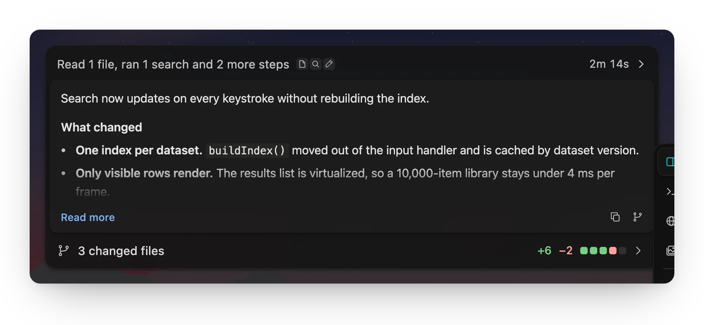

**Up to six threads at once.** Tile threads inside the thread area, each with its own
scene. The focused tile is the full thread and the others update live.

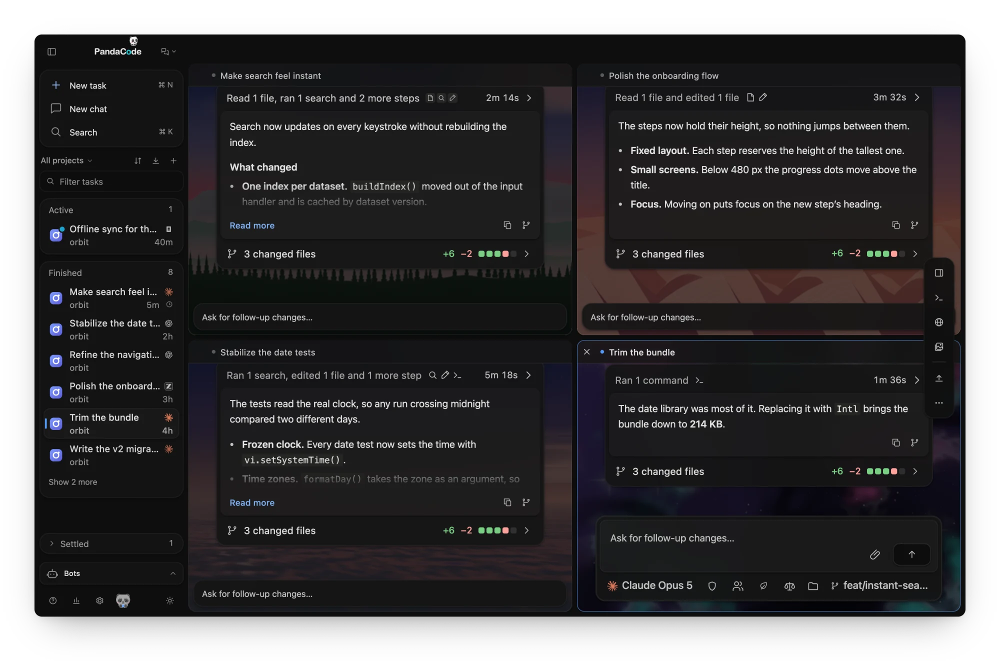

**Light or dark, with a scene that follows the clock.**

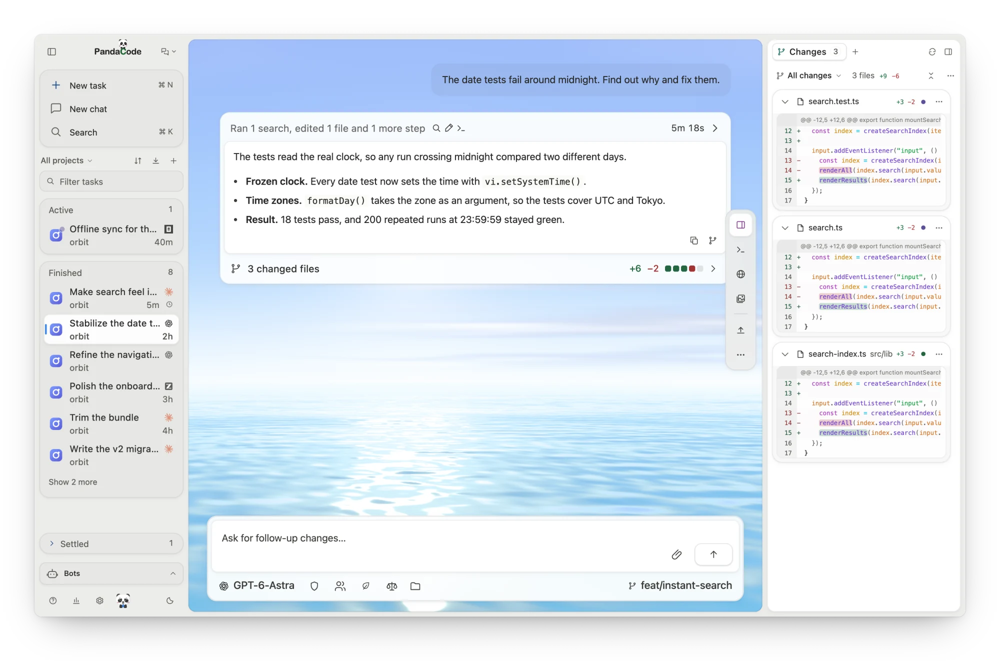

<table>
  <tr>
    <td width="62%" valign="top">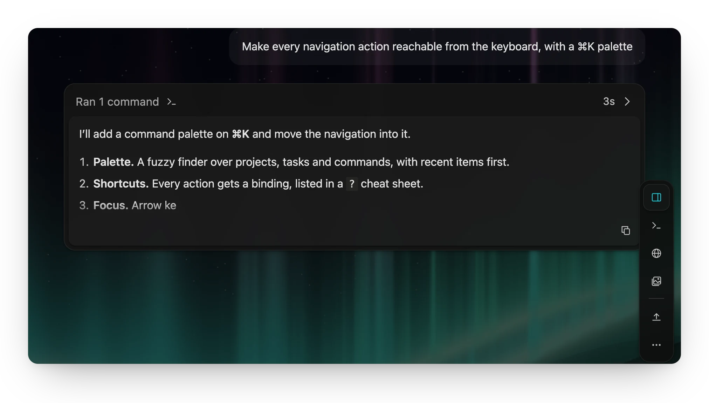<br><sub><b>Live replies.</b> Responses stream in as Markdown, under the step the agent is on.</sub></td>
    <td width="38%" valign="top">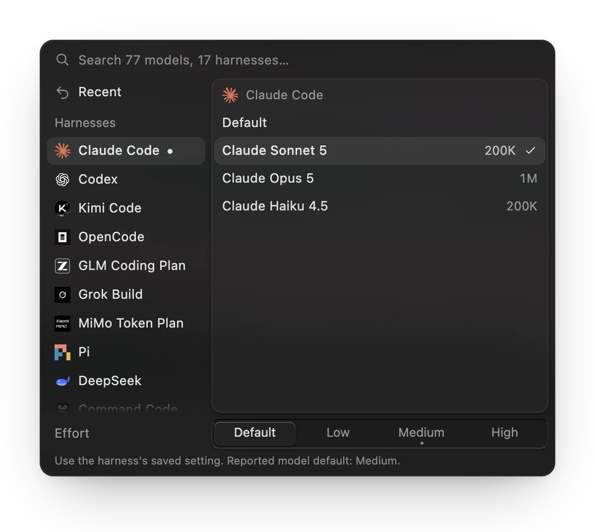<br><sub><b>Any harness, any model.</b> Switch per task, with context size and reasoning effort.</sub></td>
  </tr>
</table>

**Agent teams.** An architect plans the work, runs workers in parallel across
harnesses, and reviews what they bring back. The dock's Agents item shows every worker.

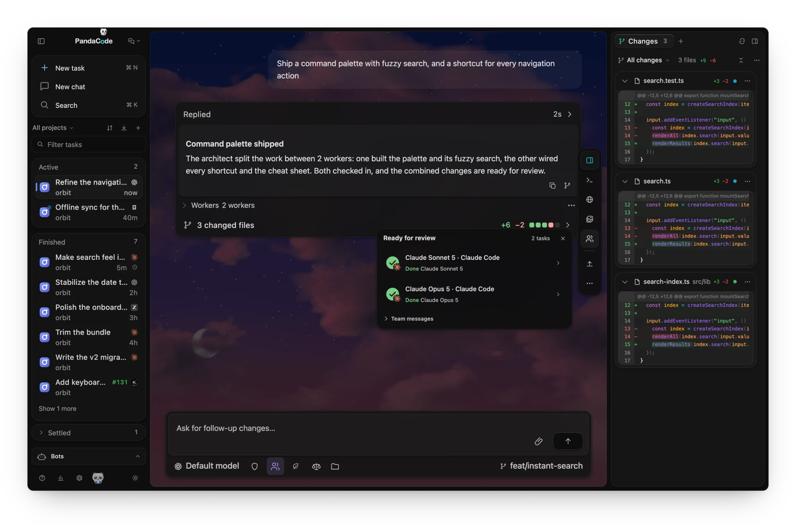

**A board for everything in flight.** Tasks from every project move from Pending to
Settled, each with its harness and linked issue.

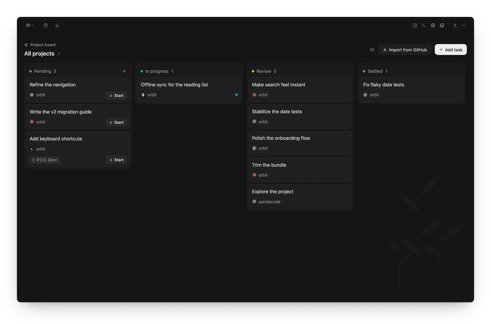

**GitHub in one view.** Your repositories with their threads, pull requests, issues
and actions, including review and CI status.

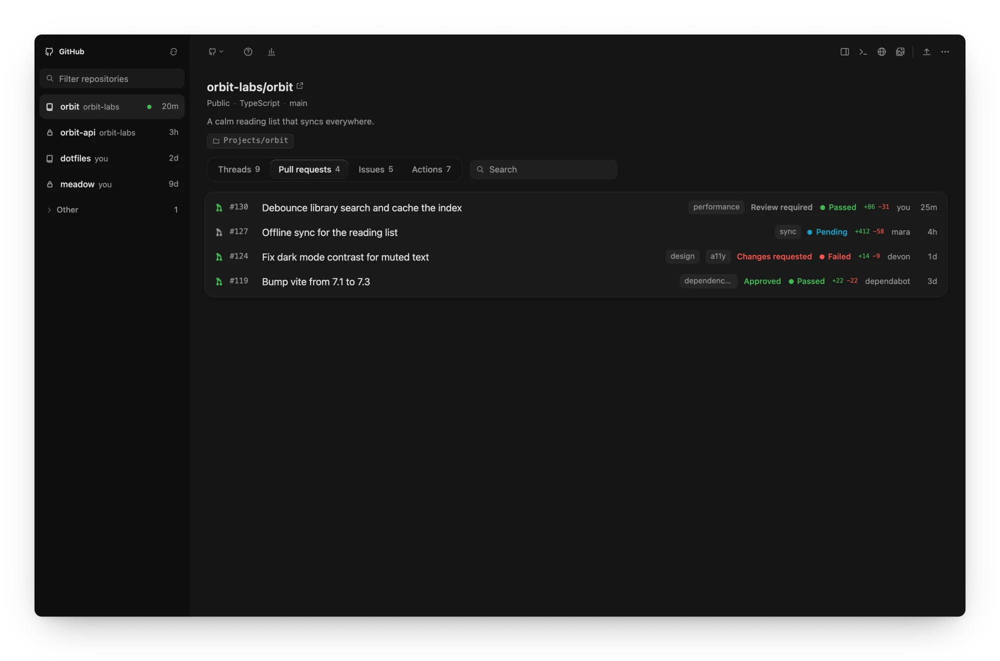

**Your app beside the chat.** The iOS Simulator and Android emulator run in the
inspector on a lifelike device, so you can tap through what an agent just built.
On Windows and Linux the tab lists Android emulators only.

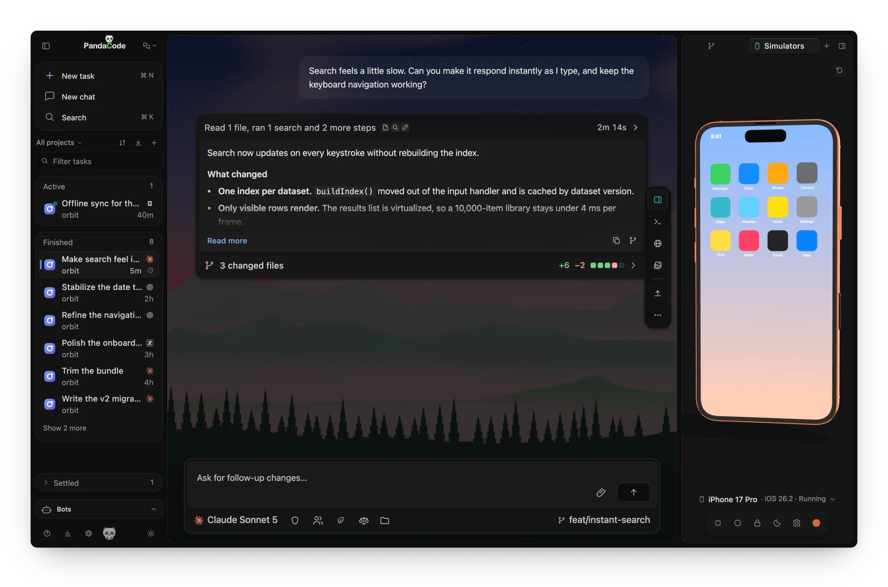

**Bots that keep working.** A bot's conversation is an ordinary task thread, with
the same streaming, composer and model picker; reach it from Telegram, Slack,
Discord, WhatsApp or a browser too.

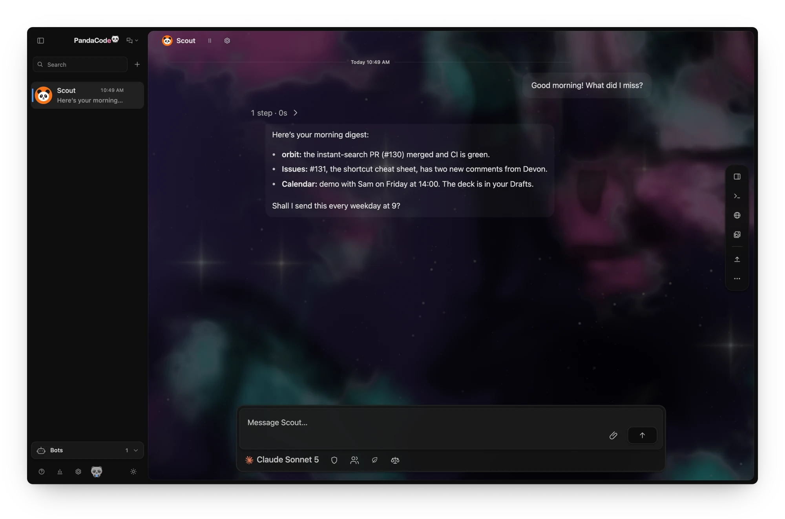

<table>
  <tr>
    <td width="58%" valign="top">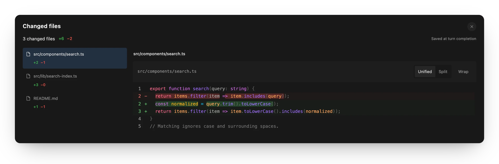<br><sub><b>Review every turn.</b> Each turn saves its changes, with unified and split diffs.</sub></td>
    <td width="42%" valign="top">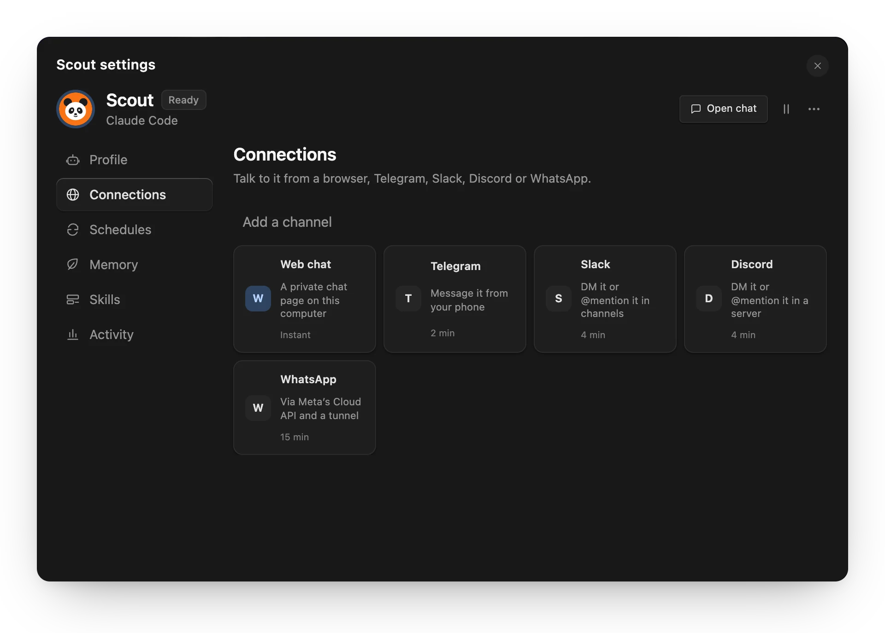<br><sub><b>Bot settings.</b> Connections, schedules, memory and skills, in one place.</sub></td>
  </tr>
</table>

**Settings in nine sections.** Recommended, General, Appearance, Voice, Agents,
Schedules, Tools, Connections and About, with colors and imported VS Code themes.

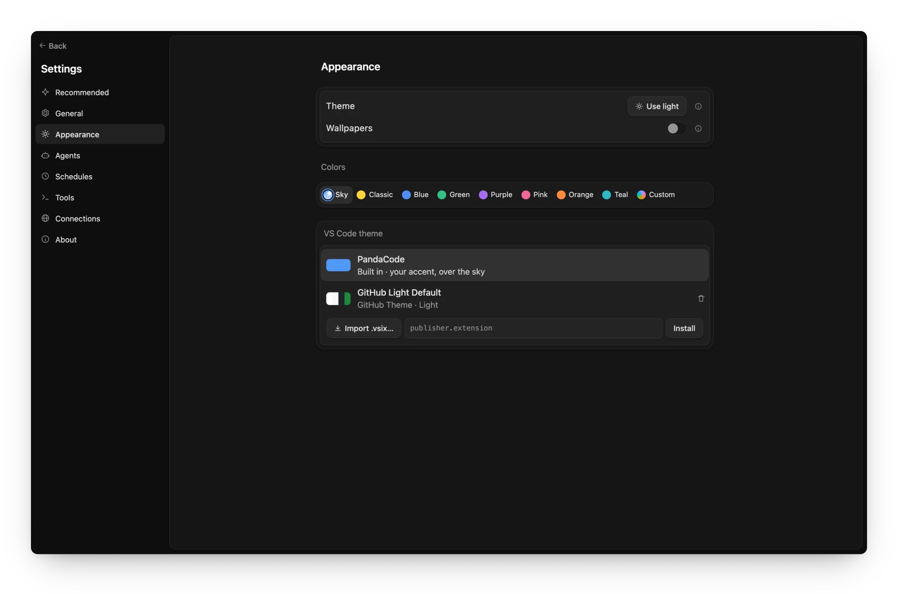

<sub>Screenshots come from the browser preview with sample data. Regenerate them with
`npm run screenshots` (see [`scripts/screenshots`](scripts/screenshots/capture.spec.ts)).</sub>

Voice dictation inserts a draft without sending it. Transcribe on your computer with a speech model you download in Settings → Voice, or send audio to a speech service you configure; see [voice input](docs/voice-input.md).

## Privacy

- **No telemetry, no analytics, no accounts.** PandaCode does not phone home.
- **Crash reports stay on your computer.** After a crash PandaCode restarts itself
  and keeps a plain-text report in `crash-reports/` in its app data folder: the 10
  newest crash reports and 5 window reports. A report holds the panic message, if any,
  which can include file paths, text from your work or a credential that was in that
  message (nothing is redacted), and a backtrace, so check it before you share it. Reports older than 90 days are deleted when a new report is written,
  each time PandaCode starts and about once a day while it runs, so one stays longer only
  while PandaCode is not running. `crash-guard.json` in the app data folder itself, not
  in `crash-reports/` (`crash-guard-serve.json` for a headless `serve` host), holds the times of the
  crashes in the 10 minutes before the latest one (at most 10; a time more than 10
  minutes old is dropped at the next crash, when PandaCode or a `serve` host next starts
  and about once a day while one runs, so it stays longer only while PandaCode is not
  running) and, until the next launch of that app or host takes it, a short notice (when,
  a cause such as "Panic" or "Crashed with SIGSEGV", whether it restarted, whether
  running agents were stopped, and the file name of its report). A notice whose crash is more than 90 days old (or dated more than a day
  ahead) is deleted at those same starts and daily checks.
  A headless `serve` host restarted after a crash writes all its output, including
  its startup line about the crash (which ends with the full path of `crash-reports/`,
  naming your home folder), its Connect GitHub login and error messages, which can name threads and contain
  project and file paths, to `serve-restart.log` (readable only by your user on macOS
  and Linux; on Windows it gets the permissions of the profile folder it is in; moved to
  `serve-restart.log.1` once past 1 MB, which the host checks every 30 seconds on macOS
  and Linux, so it can pass 1 MB by what it writes in that time, and on Windows only when
  a restart begins). The guard's own few lines go to `crash-guard.log` (moved to
  `crash-guard.log.1` past 1 MB when a guard starts). Both logs and their `.1` files are
  deleted once they have not been written for 90 days, checked when PandaCode starts and
  about once a day while it runs; a restarted host never deletes its own
  `serve-restart.log`, so that one goes at a later start. Empty `.lock` files beside
  the two state files coordinate their updates.
  The restart guard is a second PandaCode process; its command line, which other users
  of the computer can see in the process list while PandaCode runs, includes the app data
  folder's path and PandaCode's own arguments.
  Nothing is sent; Settings → General can turn automatic restarts off. See
  [crash recovery](docs/crash-recovery.md).
- **Unsent drafts are kept as plain text.** What you type in the composer (or a
  shared bot channel's) and haven't sent (up to 50,000 characters per draft) is saved unencrypted in the
  app's local web storage for up to 30 days (cleared at launch and daily while the app
  runs; longer only while PandaCode is not opened), so it usually survives a restart
  (the web view may write it to disk slightly later, so the very last keystrokes before
  a hard crash can be missing). A draft can include a secret you pasted. Turn off
  Settings → General → **Keep unsent drafts** (on by default) to save none: that removes the
  saved drafts at once and at every launch, and text in an open message box stays only until
  you quit. **Clear saved drafts** removes the drafts kept so far and keeps saving new ones
  (text showing in an open message box stays there until its next change). That storage is outside the app data folder on Windows and
  macOS: on Windows it is under
  `%LOCALAPPDATA%\ai.pandacode.desktop\`, on macOS WebKit normally keeps it under
  `~/Library/WebKit/ai.pandacode.desktop/` (see
  [what a launch restores](docs/crash-recovery.md#what-a-launch-restores)). On Linux
  PandaCode makes that folder readable only by your user at every start; on Windows and
  macOS it changes no permissions, so who can read drafts depends on what the web view
  and the parent folders allow.
- **Your code stays on your machine.** Projects, conversations and settings are
  stored locally in SQLite. Prompts go only to the coding CLI or service you
  pick, under that provider's own terms.
- **It only talks to services you choose.** Provider keys (GLM, MiMo, Alibaba Token Plan, DeepSeek, Command Code, cloud
  sandboxes, bot channels, connection secrets) are sent only to that provider.
  On macOS they live in `secrets.json` in PandaCode's app data folder, readable
  only by your user (0600), never the Keychain, so updates never ask for your
  login password; keys saved in the Keychain by older versions move there on
  first use. Linux keeps them in the Secret Service and Windows in Credential
  Manager; `pandacode serve` uses the 0600 file there too by default.
- **Agent telemetry can be turned off in one place.** Settings → Agents →
  Harnesses → Advanced → Privacy → **Turn off agent telemetry** starts every agent with its vendor's
  own opt-outs (Claude Code, Codex, Kimi, Grok, DeepSeek, Command Code, Pi,
  Muse, and OpenCode sharing) plus `DO_NOT_TRACK=1`. Your agent config files
  are not changed. Each agent's row shows what the switch covers. Cline has no
  per-launch switch, so turn it off in Cline's own settings. With the switch on,
  Claude Code also stops fetching remote feature flags (it uses its defaults)
  and can't take sessions started remotely on this computer.

A few automatic checks send no personal data — just plain requests for public
information:

| What | Where | How often |
| --- | --- | --- |
| Latest versions of installed coding CLIs | `formulae.brew.sh`, `downloads.claude.ai`, `api.github.com`, `cdn.kimi.com`, `registry.npmjs.org`, `releases.openai.com`, `storage.googleapis.com`, `pypi.org` | About every 6 hours |
| Plan usage checks for your signed-in agents | That agent's provider | When you open the menu bar item or the Usage dialog, and in Settings → Providers when account pools are shown (once, then at most every 5 minutes on window focus, or when you click Refresh) |
| Asking your Claude Code for usage when PandaCode can't read it (on by default; Settings → Providers → Claude Code → Let PandaCode ask Claude Code for usage when it can’t read it): PandaCode runs your installed Claude Code once, `claude -p /usage` (a local command: no model call, nothing billed), with only its config folder, network and process settings (its telemetry, error reports, nonessential traffic and self-update turned off for this run), which lets Claude Code refresh and save its own login if it needs to, as when you open it (it may answer from its own snapshot instead). PandaCode never writes Claude Code's credentials | Whatever Claude Code itself contacts to refresh its login and read usage (Anthropic) | Only during a Claude usage check that can't read usage (an expired, rejected or missing login, a Keychain or network problem, a rate limit with no saved reading; never for an API-key or other non-subscription setup, a locked Keychain or a Keychain read you denied unless you press Refresh), at most once per Claude setup every 15 minutes (a Refresh you press may run it once more), less often while runs keep failing (up to every 2 hours), never two at once, and never inside a rate limit's server-set wait (after it, a new rate limit with no or an old saved reading may run it); never while the setting is off |
| Public model price list (for cost estimates) | `raw.githubusercontent.com` | Daily |
| PandaCode's own updates (`latest.json` on this repository's latest release) | `github.com` | At launch and about every 6 hours unless Settings → About → Updates is Off |
| Jev decision model list (optional) | `openrouter.ai` | Only when you choose OpenRouter for Jev decisions and open the model menu or press Refresh; no key is sent |
| Jev decisions on OpenRouter (optional) | `openrouter.ai` | Only when you choose OpenRouter in Settings → Tools → Add-ons → Jev and run a decision check; sends the selected evidence with your key |
| Jev decisions on TypeSafe (optional, the default service): sends the selected evidence with your key | TypeSafe | Only when you save a TypeSafe key in Jev's setup and run a decision check |
| Cloud agents (optional): the task's checkout, prompt and harness login go to the machine you chose; PandaCode checks on its active runs | The cloud provider you connected | Only for tasks you start on a cloud provider; while a run is active and at launch to re-attach |
| Model routing profiler (optional): `model.int8.onnx` and `tokenizer.json`, from a pinned commit, verified by SHA-256 | `raw.githubusercontent.com` | Once, the first time you turn on a team (with routing on) or click Download or Route in Settings → Agents → Model routing; never at launch, and never on macOS older than 13.4 or on Intel Mac, x86_64 Linux and x86_64 Windows builds |
| PandaCode Connect (optional): GitHub sign-in, then the relay that forwards your devices' end-to-end encrypted messages | `github.com`, the PandaCode relay | Only after you sign in under Settings → Connections → Remote access; nothing before |
| Push notifications (optional, mobile app): the relay sends a generic alert ("A task finished") with a `pandacode://inbox` link to your phone's device token, never task content | Apple Push Notification service, Firebase Cloud Messaging (sent by the PandaCode relay) | Only after you allow notifications in the mobile app while signed in to Connect |
| Voice input with a speech service (optional): recorded audio, selected model and optional language, authenticated with your speech key | The transcription endpoint you configure (OpenAI, Groq, Mistral or your local/custom server) | Only with that service chosen, when you stop or transcribe a recording (Stop, Enter, Transcribe recording, Retry) or when switching threads or anything else closes the prompt box mid-recording while PandaCode keeps running; automatic stops (the two-minute or 16 MiB limit, or a failing microphone) keep the audio until you press Transcribe recording; with **This device**, audio never leaves your computer |
| Local speech models (optional): the model file you pick and, with the first one, the Silero voice-activity model (about 1 MB), from a pinned revision, verified by SHA-256 | `huggingface.co`, `*.huggingface.co` and the download CDN `*.hf.co` | Only when you click Download in Settings → Voice; nothing at launch, while browsing models or while dictating |
| Netlify token check (optional): verifies the token and project you enter | `api.netlify.com` | Only when you save a Netlify token in Settings → Connections → Cloud sandboxes |
| Adding skills (optional): `npx` fetches the `skills` CLI from the npm registry set in your `~/.npmrc`, which reads the source you choose: a GitHub or GitLab repository, or a local folder (telemetry off) | `registry.npmjs.org` (or your configured registry), `github.com` or `gitlab.com` | Only when you click Find skills, choose a folder or click Install in Settings → Tools → Skills; listing and switching skills are local |

## Install

Download the latest build from
[GitHub Releases](https://github.com/aicodeking/pandacode/releases/latest):

| Platform | File | Requirements |
| --- | --- | --- |
| macOS (Apple silicon) | [`PandaCode-macOS-arm64.dmg`](https://github.com/aicodeking/pandacode/releases/latest/download/PandaCode-macOS-arm64.dmg) | macOS 12+ |
| macOS (Intel) | [`PandaCode-macOS-x64.dmg`](https://github.com/aicodeking/pandacode/releases/latest/download/PandaCode-macOS-x64.dmg) | macOS 12+ |
| Windows x64 | [`PandaCode-Windows-x64-setup.exe`](https://github.com/aicodeking/pandacode/releases/latest/download/PandaCode-Windows-x64-setup.exe) | Windows 10 1809+ or Windows 11 |
| Windows arm64 | [`PandaCode-Windows-arm64-setup.exe`](https://github.com/aicodeking/pandacode/releases/latest/download/PandaCode-Windows-arm64-setup.exe) | Windows 11 on ARM (Snapdragon X and similar) |
| Linux x64 | [`PandaCode-Linux-x86_64.AppImage`](https://github.com/aicodeking/pandacode/releases/latest/download/PandaCode-Linux-x86_64.AppImage) | Ubuntu 22.04+ or compatible, X11 or XWayland |
| Linux arm64 | [`PandaCode-Linux-aarch64.AppImage`](https://github.com/aicodeking/pandacode/releases/latest/download/PandaCode-Linux-aarch64.AppImage) | Ubuntu 24.04+ aarch64 or compatible, X11 or XWayland |

Or from a terminal: `npx pandacode` downloads the latest build, verifies its
update signature and installs it (on macOS it also signs the installed app locally).
`npx pandacode --dry-run` only downloads and verifies.

With [Homebrew](https://brew.sh): `brew install --cask aicodeking/pandacode/pandacode`
on macOS, or `brew install aicodeking/pandacode/pandacode` on Linux
([details](docs/homebrew.md)).

The official macOS builds are Developer ID signed and notarized by Apple
([verified for v0.3.103](https://github.com/aicodeking/pandacode/actions/runs/42462913784)).
macOS may still ask you to confirm opening a downloaded app. Signing remains
optional for [local and fork builds](docs/releasing.md#optional-signing), whose
ad-hoc builds need the instructions there. Windows and Linux builds are not
code-signed:

- **Windows:** if SmartScreen appears, click **More info → Run anyway**.
- **Linux:** `chmod +x PandaCode-Linux-x86_64.AppImage` (or `-aarch64`), then run it. Some
  distributions need FUSE 2 (`libfuse2`), or set `APPIMAGE_EXTRACT_AND_RUN=1`.
  The AppImage runs through X11 (XWayland on Wayland) by default; if the window
  stays blank there, try GTK's native Wayland backend with
  `GDK_BACKEND=wayland ./PandaCode-Linux-x86_64.AppImage`.

Each file has a `.sha256` checksum beside it. Once installed, PandaCode updates
itself: it checks the latest release, downloads a newer version in the background,
verifies its signature, and restarts to install it when no agent is working and
you've stepped away (or when you click **Restart to update**). In Settings → About,
**Notify me** checks but asks first (**Install and restart** / **Later**), and **Off**
stops checking. On Linux only the AppImage updates itself; an unpacked AppImage or a
package just reports new versions. See [platform support](docs/platform-support.md) for details.

Then install Git and at least one coding CLI and sign in with its normal login.
PandaCode does not include provider plans or usage.

[Pi](https://github.com/earendil-works/pi) installs with `npm i -g @earendil-works/pi-coding-agent`; sign in through Pi's own CLI. PandaCode drives it over Pi's RPC mode and gives it PandaCode's app tools through a local loopback bridge extension. Pi has no approval system of its own, so PandaCode's extension enforces the permission modes; the integrated console needs Full access.

[omp (Oh My Pi)](https://github.com/can1357/oh-my-pi), a Pi fork that runs on Bun, installs with `bun install -g @oh-my-pi/pi-coding-agent`; sign in through `omp` itself. PandaCode drives it with the same RPC bridge as Pi and passes `--approval-mode yolo` so the bridge stays the only approval gate.

[DeepSeek](https://platform.deepseek.com/api_keys) installs with `npm i -g @deepseek-ai/dsh`; PandaCode launches `dsh --profile acp`. An API key is optional (Settings → Agents → Providers, or `DEEPSEEK_API_KEY`); dsh can use its own stored credentials. With a saved key (or `DEEPSEEK_API_KEY`), the Usage dialog shows the account balance from `api.deepseek.com`.

[Command Code](https://commandcode.ai/docs/acp) installs with `npm i -g command-code` (Node 22 or newer); PandaCode launches `command-code acp`. Sign in once with `command-code login`, or save an API key in Settings → Agents → Providers (or set `COMMAND_CODE_API_KEY`); either one authenticates the same account. Usage limits are not shown in PandaCode; check Command Code Studio.
[Cline](https://docs.cline.bot/usage/cli-overview) installs with `npm i -g cline`; PandaCode launches `cline --acp`. Sign in once with `cline auth` (or set `CLINE_API_KEY`); the provider and models chosen in Cline apply. See [provider details](docs/providers.md#cline).

[Kilo Code](https://kilo.ai/docs/code-with-ai/platforms/cli) installs with `npm i -g @kilocode/cli`; sign in with `kilo auth login`, then select **Kilo Code** in PandaCode. PandaCode launches `kilo acp` and uses Kilo's configured providers and models. See [provider details](docs/providers.md#kilo-code).

Muse Code installs with Meta's launcher into `~/.local/bin/muse`; run `muse login` once in a terminal. PandaCode launches `muse serve` and speaks MSP, Muse's JSON-RPC session protocol, with its sandbox and approval modes; see [docs/providers.md](docs/providers.md#muse-code) for what each mode does and what Muse cannot express.

Antigravity runs Google's `agy_acp_server`, or `agy acp --process-per-session` through the `agy` CLI when that server isn't installed. See [provider details](docs/providers.md).

[GitHub Copilot CLI](https://docs.github.com/en/copilot/how-tos/set-up/install-copilot-cli) installs with `npm install -g @github/copilot`; run `copilot login` in a terminal, then select **GitHub Copilot CLI** in PandaCode. PandaCode launches the local `copilot` executable over ACP. The CLI manages its own sign-in. See [provider details](docs/providers.md#github-copilot-cli).

[Devin CLI](https://docs.devin.ai/cli) installs with `curl -fsSL https://cli.devin.ai/install.sh | bash` (or `brew install --cask devin-cli`, or the copy bundled with Devin Desktop); run `devin auth login` once in a terminal, then select **Devin CLI** in PandaCode. PandaCode launches `devin acp` with the CLI's own sign-in and lists every Devin model with its own thinking levels. See [provider details](docs/providers.md#devin-cli).

[ZCode](https://github.com/zai-org/ZCode) installs with its install script (`~/.local/bin/zcode`, Node 24); run `zcode` once in a terminal and sign in, then select **ZCode** in PandaCode. PandaCode talks to `zcode app-server` directly — the CLI's own protocol, since it exposes no ACP mode — listing every model the account can reach with its own reasoning levels. See [provider details](docs/providers.md#zcode).

[Hermes Agent](https://hermes-agent.org) installs with `curl -fsSL https://raw.githubusercontent.com/NousResearch/hermes-agent/main/scripts/install.sh | bash`; run `hermes acp --setup` or configure `~/.hermes/config.yaml`, then select **Hermes Agent** in PandaCode. PandaCode launches `hermes acp` and uses Hermes' configured provider and models. See [provider details](docs/providers.md#hermes-agent).

## Build from source

You need Node.js 22, stable Rust, and the
[Tauri prerequisites](https://v2.tauri.app/start/prerequisites/) for your OS.

```sh
git clone https://github.com/aicodeking/pandacode.git
cd pandacode
npm ci
npm run desktop        # same as: npm run tauri dev
```

`npm run dev` serves only the frontend. In a regular browser it runs a labeled,
device-local sample workspace for UI work; files, Git and terminals are
simulated there. `npm run tauri build` makes a local installer, and
`npm run release:build` builds the release asset for your OS (see
[releasing](docs/releasing.md)).

The website lives in [website/](website/): `npm run site:dev` and
`npm run site:build`.

## Use

Open a project folder, then click **New task** or press `⌘/Ctrl N`. A centered
"What should we build in …?" page opens in the last active project with the
message box focused. Choose the harness and model from the searchable picker in
the message box; new tasks remember your last choice. The **+** button attaches
images, documents, folders, project files or a mockup. Open **Changes** to
inspect and stage diffs, or the terminal to run shell commands. Conversations
and provider session IDs persist across restarts; agents start only for active
turns.

In **Files**, an HTML file opens in the Browser panel; other files, including images,
PDFs, Word documents and spreadsheets, open in a file tab beside the conversation.
Filenames mentioned in responses become clickable and resolve against the task's
own project or worktree.

The row at the bottom of the prompt box holds the model, permissions, Team, token
saver, checkout and branch. Its branch chip
is the one place for [worktrees](docs/worktrees.md): an unstarted task moves into
a new worktree in place, a started one spawns a sibling task, and settling a
clean worktree task offers to remove its checkout and merged branch.

Pick **Board** from the view menu beside the PandaCode name to manage tasks by
status. Choose **Team** in the composer for an automatic team, or set up an architect
and workers. Each agent turn is one card, with its tool calls behind the header;
approval requests wait in the bar above the prompt.

On macOS and Windows, closing the window hides it and running agents keep going; the
menu bar item, the Dock or launching the app again brings it back. On Linux, closing
the window quits PandaCode.

The branch chip also switches the project checkout to `main` or another local
branch, and in a worktree task offers **Merge into main**: it merges the
worktree's committed work locally, refuses uncommitted changes or conflicts
without touching anything, then offers to remove the worktree.

**Standard** permissions keep each provider's native checks. Claude's **Accept
edits** allows its editing tools; Codex uses its workspace sandbox with
on-request approvals. **Full access** enables the harness's broadest mode. See
[provider details](docs/providers.md).

Type `/` at the start of a message for the harness's commands and skills
([slash commands](docs/slash-commands.md)).

Keyboard shortcuts: `⌘/Ctrl N` new task, `⌘/Ctrl K` command palette,
`⌘/Ctrl J` terminal, `⌘/Ctrl B` sidebar, `⌘/Ctrl ,` settings, `⌘/Ctrl F` find
in thread (`⌘/Ctrl G` next match), `Enter` send (queues while an agent runs),
`⌘/Ctrl Enter` steer, `Shift Enter` newline, `⌘⌥←/→` move between tiled threads,
`⌘/Ctrl +/−/0` interface size (the whole interface scales, not just text).

On macOS, if folder access is denied, use **Browse** to select the folder, or
allow PandaCode under **System Settings → Privacy & Security → Files & Folders**.

The thread shows one of eight live scenes that follows the time of day, and each
thread keeps its own. PandaCode also includes [21 anime scenery wallpapers](docs/wallpapers.md), a different morning,
afternoon and night scene for each weekday: turn them on in **Settings →
Appearance → Wallpapers**. You can also import VS Code color themes.

The [optional Jev add-on](docs/jev.md) adds work review, project-rule checks and
app testing in isolated Chrome profiles. It is off by default and PandaCode works
fully without it.

## Resource limits

No background directory polling or recursive file watchers. Agents exit after
each turn and resume by provider session ID; a run stays open only while background
subagents finish or a Codex goal is active. After a Claude Code turn, the next
turn's process starts in the background so a follow-up skips the CLI's startup;
at most two wait at a time, each for up to 10 minutes. PandaCode's fixed
instructions go to Claude-family harnesses once as a cached system prompt rather
than in every message. Motion is short and subtle, and the system's reduced-motion setting turns it off; a
thread you return to draws from its saved page at once. Terminal and Markdown code load only
when needed. Terminal history, provider frames, files, diffs and streamed text
all have explicit limits; only the current 100-message page of a conversation is
loaded. **Resource usage** reports native core RSS, active agents, terminals and
database size (core RSS excludes the system webview and provider processes).

## Tests

```sh
npx tsc --noEmit           # typecheck
npm run build && npm test  # unit tests (some read dist/)
npm run test:release       # release script tests
npm run test:rust          # cargo test
npx playwright test        # browser suite (Chrome)
npx playwright test -c playwright.webkit.config.ts   # WebKit
```

Ordinary tests make no paid model calls. Opt-in live tests are `#[ignore]`d;
see [providers](docs/providers.md).

## Contributing

Contributions are welcome. Read [CONTRIBUTING.md](CONTRIBUTING.md) for setup and
the pull request process, and [AGENTS.md](AGENTS.md) for code conventions. Please
follow the [Code of Conduct](CODE_OF_CONDUCT.md), and report security issues
privately as described in [SECURITY.md](SECURITY.md). Bugs and ideas go in
[GitHub issues](https://github.com/aicodeking/pandacode/issues).

Architecture notes: [design](docs/design.md), [native IPC](docs/ipc.md),
[research](docs/research.md). Provider protocols live in
`src-tauri/src/providers.rs` behind one normalized event interface; ACP harnesses
share `acp.rs`.

## Data

Data lives in Tauri's per-user application data directory (on macOS,
`~/Library/Application Support/ai.pandacode.desktop/`) in `kingcode.sqlite3`; the
database keeps its legacy internal name. Project source stays in the folders you
open, and removing a project from the app never deletes its files.

## License

[PandaCode License](LICENSE) (MIT with an attribution requirement for forks) ©
2026 PandaCode contributors. Provider names and logos belong to
their owners and do not imply endorsement ([brand assets](docs/brand-assets.md)).
Bundled third-party components and their licenses are listed in
[THIRD_PARTY_NOTICES.md](THIRD_PARTY_NOTICES.md). A copy ships inside the app, and
Settings → About → Third-party notices opens it.
