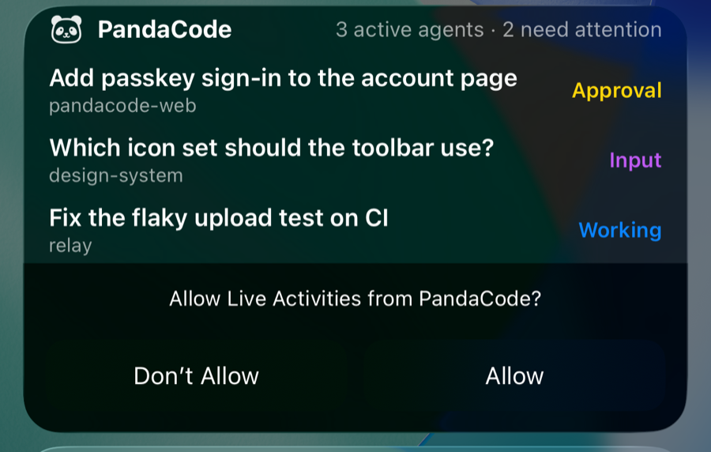

# Live Activities and the Dynamic Island

PandaCode for iPhone shows one Live Activity that sums up every computer's running and waiting
tasks: on the Lock Screen, in Notification Center and in the Dynamic Island.

- **Lock Screen card:** the panda mark, `3 active agents · 2 need attention`, and up to four rows of
  task title, project and status (Approval yellow, Input purple, Working blue, Done green, Failed
  red). Tasks that finish while the activity is up stay as Done rows.
- **Dynamic Island:** compact shows the mark and the running count, or a yellow dot when a task
  needs you; minimal shows the dot or the mark; expanded shows the top three tasks.
- **Tap:** opens the task when only one is involved (`pandacode://task/<device>/<session>`),
  otherwise the inbox (`pandacode://inbox`).
- **Lifetime:** starts when any task runs or waits, updates at most every 2 s and only when the
  summary changes, and ends 2 minutes after everything settles (it stays on the Lock Screen for
  15 more minutes). Snoozed tasks are left out, as in the inbox.

## How it is built

- [`expo-widgets`](https://docs.expo.dev/versions/v58.0.0/sdk/widgets/) (Expo-maintained, SDK 58)
  adds the widget extension target `ExpoWidgetsTarget` at prebuild and the ActivityKit bridge.
  The layout is Expo UI SwiftUI components in `mobile/src/live/PandaActivity.tsx`; the
  `'widget'` directive ships it to the extension as source.
- `mobile/src/live/summary.ts` turns the inbox (`src/store/inbox.ts`) into the activity's props
  (tested in `summary.test.ts`); `LiveActivityHost.tsx` starts, updates and ends it and is mounted
  once in `src/app/_layout.tsx`.
- The mark (`src/live/mark.png`) is copied at launch into the App Group directory the extension
  can read.
- Off on Android (the module is excluded from Android autolinking), on binaries built without the
  module, and whenever ActivityKit refuses (Live Activities turned off in Settings).
- `app.json`: `NSSupportsLiveActivities`, extension bundle ID
  `com.aicodeking.pandacode.LiveActivity`, App Group `group.com.aicodeking.pandacode`. These need a
  new native build (`eas build`); an OTA update alone does nothing on older binaries. EAS registers
  the extension's App ID and the App Group at that build ([SUBMITTING.md](SUBMITTING.md) step 6).

## The limit: updates stop in the background

The phone gets task changes over the Connect relay socket, which iOS closes about 30 seconds after
the app goes to the background. From then on the app cannot update the activity. So every update
made while the app is in the background carries a `staleDate` 45 s after it left the foreground;
past that, iOS marks the activity stale and the card and expanded island say
**Open PandaCode to refresh · 9:41** (the time of the last data) and grey out the status colours.
Opening the app reconnects, refreshes the activity and clears the staleDate.

## Follow-up: full background updates over APNs

Keeping the activity live while the app is closed needs ActivityKit push updates:

1. **APNs key.** An APNs auth key (`.p8`, Key ID, Team ID) from the Apple Developer account,
   stored as a secret of the relay Worker (`wrangler secret put`), never in the app.
2. **Push tokens.** Set `enablePushNotifications: true` for `expo-widgets` in `app.json` (adds the
   `aps-environment` entitlement; new build). The app reads each activity's token with
   `LiveActivity.addPushTokenListener` (and, on iOS 17.2+, the push-to-start token with
   `addPushToStartTokenListener`) and registers it with the relay for this phone, replacing the
   old one when it rotates and deleting it when the activity ends.
3. **Relay sender.** The relay already sees, per account, when a host pushes events to a
   subscribed phone. It would send `apns-push-type: liveactivity` requests to
   `api.push.apple.com` with topic `com.aicodeking.pandacode.push-type.liveactivity`, an
   `event` of `update` or `end`, a `timestamp`, a fresh `stale-date`, and `content-state`
   matching the activity's `ContentState` (`{ name: "PandaActivity", props: "<LiveSummary JSON>" }`).
   Apple budgets these; use `apns-priority: 5` for routine changes and 10 only for "needs you".
4. **Who builds the summary.** Today the relay forwards only end-to-end encrypted frames
   (X25519 + XChaCha20-Poly1305) and cannot read task titles. Either the host builds the summary
   and sends it to the relay for APNs in plaintext, or it sends only counts.

**What would pass through Apple.** APNs payloads are not end-to-end encrypted to the phone: Apple
and the relay would see whatever `content-state` carries. With full rows that is task titles,
project names and statuses. The privacy-preserving option is counts only (`3 active · 2 need
you`, no titles), with titles filled in when the app next opens. Either choice must be listed in
the README privacy table, the website privacy page and the App Store privacy answers before it
ships, since it is a new automatic request with user data.
