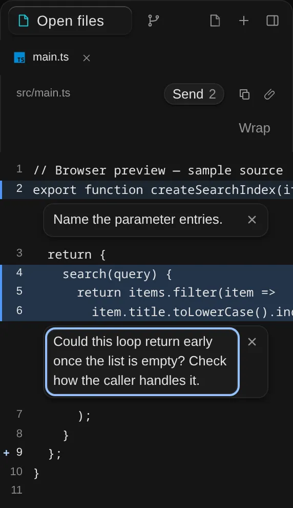
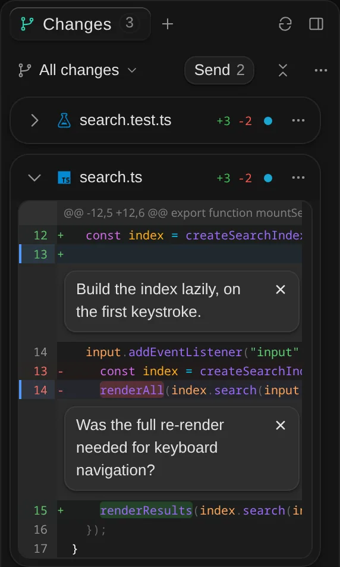
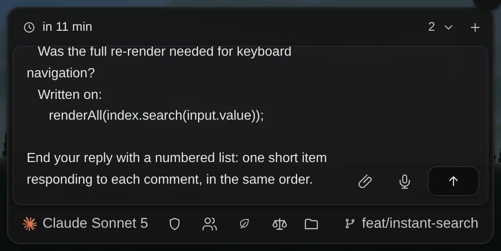

# Line comments

Review comments on a line or a range of lines, left in the Files view's code preview or in a Changes
diff, then handed to the thread's agent in one message. Upstream issue: aicodeking/pandacode#360.

Line comments are a frontend-only way to write that message, kept like composer drafts: per thread,
in local storage, until **Send N comments** (named "… to agent") adds them to the composer and
clears them. There is no native storage, no resolved state and no agent tool; the agent sees the
comments only as text in the user's message, and ends its reply with one item responding to each.

A comment can ask for a change or ask a question, so besides asking for edits, comments can prepare
a code review: check a set of things with the agent, then use that conversation to post review
comments on the pull request.

## Code

- `src/review-comments.ts`, loaded at startup: the store and its storage and cleanup, the prompt,
  the Send button and the announcer (styled by `src/review-send.css`, also loaded at startup).
- `src/review-comments-ui.ts` and `src/review-comments.css`, loaded the first time a code file or a
  Changes diff is shown with a thread, or the Changes view has comments no view shows
  (`reviewUi()`): the comment fields and their focus hand-off, the line numbers' keys, the Files
  view's line numbers (`mountFileComments`), the first-use hint (`mountCommentHint`) and the group
  of comments no view shows (`mountAwayComments`).
- `src/review-comments-diff.ts`, loaded with the first Changes diff shown with a thread
  (`reviewDiffUi()`, which brings the UI module with it): the diff's hooks (`createDiffReview`) and
  its keyboard path to pierre's line numbers (`diffKeys`).
- `src/review-anchor.ts`: anchoring and patch reading, pure.
- `src/stored-budget.ts`: the local storage helpers (safe reads, expiry, a write that keeps to a
  budget) shared with composer drafts (`src/launch-restore.ts`).
- Hooks: `src/document-viewer.ts` (`CodeDecorator`), `src/file-tabs.ts`, `src/diff-viewer.ts`
  (`DiffViewerInput.review`, typed as `DiffReviewHooks`: the viewer never imports the feature) and
  `src/changes-view.ts`; wiring in `src/main.ts` (`reviewStore`).

Tests: `tests/review-comments.test.mjs` (pure parts and the store), `tests/stored-budget.test.mjs`
(the storage helpers), `tests/review-comments.spec.ts` (browser).

## Screenshots

A saved comment and a range being written in the Files view (the pointer is on line 9, whose
number shows the **+**):



Comments on added and deleted lines of a Changes diff:



**Send N comments** puts the diff's two comments in the composer. The composer shows about seven
lines, so it is scrolled to the end here: the comment on deleted line 14 with the line it quotes,
and the closing request; above it, out of view, is `1. src/components/search.ts, line 13`:



## What the user sees

- **Starting a comment**: click a line number (it shows a **+** on hover and keyboard focus, and a
  tooltip); drag down the numbers, or click one and Shift-click another, for a range. Until the
  user's first comment, a faint "Click a line number to comment" line sits in the code's toolbar
  and above the Changes list (one `pandacode.lineCommentHintSeen` flag in local storage then hides
  it for good). Prose files (Markdown, text) render as a reader and take no comments (see Out of
  scope).
- **Diffs**: a comment targets the new side (added and context lines) or the old side (deleted
  lines). A range between a deleted line and an added or context one comments on the new-side lines
  among the rows it covers, highlights only those while it is drawn, and says which deleted lines it
  leaves out ("Deleted lines 13–14 not included"): on its field, then on the saved comment and in
  the message (the comment keeps them as `dropped`). A range stays in the hunk it starts in: the
  lines in the collapsed gap between hunks are not shown.
- **Keyboard**: the line numbers are one Tab stop (a roving tabindex) named "Line 12, add comment"
  ("Deleted line 13, …", "…, commented, …"). Up and Down (Home, End) move; Shift extends a range
  (in a diff, to the edge of its hunk); Enter or Space opens a comment; Escape drops the range.
  Closing a comment from the keyboard puts focus back on its line number (in a diff, once pierre
  redraws it, unless focus has gone to another field meanwhile). In a diff the Tab stop is
  set up only once the diff is used, so a diff nobody comments on does no extra work.
- **Screen readers**: one polite live region says "Comment added on lines 4–6", "Comment restored"
  and "N comments added to the message"; "Comment deleted" is the app's toast. Covered and selected
  rows carry `aria-description` in the file view; in a diff the focused number's name says whether
  its line is commented.
- **The comment** is its text, in a field directly below the last line it covers. Its lines are
  highlighted (an accent tint, and an accent edge on the line number that stays inside the focus
  ring), so the card repeats no line numbers. There are no Comment, Save or Edit buttons:
  - A new comment's field opens focused, saying "Comment · ⌘↵ saves" ("Ctrl+↵" off a Mac; one
    row in a diff at the inspector's default width; its description names the other keys and ×). Leaving it with text (a click elsewhere,
    Cmd/Ctrl+Enter or Escape) saves it: typed text is never thrown away by a key. Left empty it
    goes; × discards it.
  - Clicking a saved comment edits it in place; leaving saves, Escape puts back the saved text. A
    comment emptied and left, or removed with ×, is deleted, and the toast offers **Undo** (and
    Cmd/Ctrl+Z) for a few seconds, which puts it back in its place.
  - Fields grow with their text to three rows, then scroll. Enter and Escape ignore IME composition
    keys.
  - A comment being written survives its view being drawn again (a diff refetched while the agent
    edits the file, a tab re-rendered, Wrap): the new comment and unsaved edits live in the store
    (`store.surface()`), not the view. A field still focused when its view goes for good (tab
    closed, thread switched, a diff falling back to plain text) is saved as leaving it would.
  - A comment being written follows its lines when the content changes under it. If its lines
    changed, it stays put saying "Lines 4–6 changed while you were writing", and is saved as
    Outdated; in a diff that no longer shows its lines it moves above the first hunk.
- **Outdated** comments (their lines are gone) carry an "Outdated" badge, sit near their old
  position and are not highlighted. A diff comment whose lines the diff no longer shows sits above
  the first hunk, saying so.
- **Comments on files not shown**: a diff comment whose file has left the Changes list (committed,
  reverted, hidden by the scope) or whose diff is plain text, and a Files view comment on a file with
  no tab open in its thread (closed, renamed, or after a restart), are listed in a group at the top
  of the Changes list under their file and lines, editable and deletable, and still sent. Once the
  diff or tab is back, the comment returns there. A comment being written when its file leaves the
  list (the agent commits it) is saved as leaving its field would, and listed there too.
- **Send N comments**, in the Files view header and the Changes header, shows while the thread has
  comments (a new one holding text included; a saved one whose field has been emptied and not left
  is not counted). It adds every comment of the thread to the composer, after whatever the draft
  already says, without sending it, and clears them. A comment whose field was emptied and not left
  is neither sent nor deleted by Send: leaving its field deletes it, with Undo. With no composer on
  screen nothing is cleared. It never shrinks and always says "Send": "Send N comments" in a wide
  header, "Send", a speech bubble and the count below 480px, "Send" and the count below 400px (the
  inspector's default width is about 286px). There, the Files header's Attach button shows its icon
  only, and the Changes header drops its line counts and, below 340px, its file count (each file's
  row keeps its own counts), so the scope picker and the path keep their room
  (`src/review-send.css`).

The thread is the scope: comments are kept per thread, file tabs only take comments for files
opened in that thread, and switching threads shows that thread's comments only. A New task with
comments (and nothing else) is kept like one with typed text. Turning a New task into a chat moves
its typed text and attachments, not its comments, which stay with the project.

The Files view and the Changes diff keep separate sets of comments on the same file (side `file`
versus `new`/`old`). Send sends both.

## Limits

- **File preview**: the code preview draws the first 2,000 lines. A comment on lines further down
  sits after the last drawn row with a note naming its lines.
- **Diff highlight**: one comment tints at most 400 lines (`HIGHLIGHT_CAP`, each line is a selector
  in the viewer's shadow CSS); a longer comment says so.
- **Cost when unused**: startup loads only the store, the Send button and their few CSS rules. The
  comments' UI chunks start loading with the first Changes diff, which never waits for them: a diff
  mounted before they arrive takes its hooks when they do and is drawn again once (line selection,
  the line numbers' CSS; its root then carries `data-review-hooks`, and focus already in it puts the
  Tab stop on the line numbers); later diffs have them from the start. A diff reads its patch's lines only
  once it has a comment or a selection, and a diff with no comments hands pierre no annotation list
  at all (an empty one makes a virtualized diff's parked rows drift, `tests/diff-perf.spec.ts`).
- **Colours**: saved comments tint a diff's code lines only faintly (8%; 11% while one is written),
  so commented added and deleted lines stay green and red. Increase Contrast draws a text-coloured
  edge instead. Forced colours fill the line numbers with Highlight and outline each range as one
  block (dashed while selected): its sides on every row, its top on the first and its bottom on the
  last, drawn as an overlay so rows keep their height.

## Keeping unsent comments

Unsent comments outlive a restart or a crash the way composer drafts do, under the same Settings
switch (**Keep unsent drafts**):

- One local storage key per thread, `pandacode.lineComments:<thread id>` →
  `{"t":savedAt,"comments":[…]}`, rewritten at every change and read the first time the thread is
  shown. Text still being typed is written too, half a second after typing rests and as the page
  goes, and comes back as saved comments.
- They go when sent, when the last one is deleted, when their thread is deleted (also while the app
  was closed: boot checks drafts and comments together, with one `sessions_missing` call), when
  malformed, or when they expire as drafts do (30 days untouched, or dated more than a day ahead).
- All threads' stored comments together stay within 500,000 characters (the drafts' budget), so
  they never crowd out drafts: the oldest leave storage first and stay for the running launch. A
  thread's comments past 200,000 characters, or a full store, stay for the running launch only.
- A New task's comments are kept under its draft thread's id, which does not outlive the launch.
- With **Keep unsent drafts** off nothing is written, and turning it off or **Clear saved drafts**
  empties storage; comments already made stay for the running launch.

## Anchoring

A comment remembers the text of its lines, up to three lines of context on each side and, in the
Files view, whether that text was the only copy in the file. Whenever a view paints, each comment is
looked for in the current content (`src/review-anchor.ts`, which documents the rules):

- Still at its lines with its context: unchanged. Moved: it follows the copy whose surroundings match
  best. Its lines edited in place (their context all still there): **Outdated**, never moved onto
  another copy of the old text. A line with no context left is followed only when it says something
  (a letter or digit) and was, and is, the only copy in the file.
- Its lines deleted (the function they were in removed): **Outdated**, not moved onto a similar line
  elsewhere. A copy away from its old place is followed only when the context that agrees with the
  anchor says something, or is all of it: a `}` or blank line beside another `return null;` is no
  evidence. While its old place still holds its text, any agreeing context (a blank line too) may
  pick between copies.
- A diff shows only some lines, so there a comment is Outdated only when the diff shows all of its
  lines and they differ; otherwise its place is unknown and it keeps its lines, shown on them when
  the diff shows them, else above the first hunk.
- A comment found again with new surroundings remembers them, so the next search goes by the code
  as it is now. An Outdated comment whose text comes back is open again.

## Prompt

`reviewPrompt()` lists every comment of the thread, then asks the agent to end its reply with a
numbered list, one item responding to each comment (`SUMMARY_REQUEST`). It stays generic because a
comment may be a request or a question; once sent, comments are not tracked, so that list is the
record of what became of them. A comment that a view shows on its lines is located by its file and
lines alone. Any other (Outdated, above the first hunk, on a file not shown, or whose view is not
open), and any comment on deleted lines (their numbers are in the previous version), quotes the
code it was written on, dedented and cut to 12 lines, so the agent can find it. A range that left
out deleted lines says which.

```
1. src/a.ts, lines 4–6
   the comment text

2. src/b.ts, line 13 (deleted lines)
   another comment
   Written on:
      legacy();

3. src/b.ts, lines 20–22 (deleted lines 21–22 not included)
   a range across deleted and added lines

4. src/c.ts, line 2 (these lines have since changed)
   an outdated comment
   Written on:
      const total = items.length;

End your reply with a numbered list: one short item responding to each comment, in the same order.
```

## Out of scope

- Keeping comments after they are sent, and marking them resolved: the agent's per-comment list in
  its reply takes that place.
- Posting line comments to a GitHub pull request review directly. They can prepare one instead:
  send them, talk them through with the agent, then have the conversation post the review.
- Carrying comments over when a thread is forked or its work merged into another thread.
- Comments in saved turn diffs (`change-review.ts`), the PR tab and the single-file inspector diff:
  those show snapshots, against which relocation would mark comments outdated.
- Prose files (Markdown, text) in the reader: comments there need each rendered block mapped back to
  its source lines (and a selection affordance in rendered text); a later change.
- PandaCode's own dictation in comment fields: see Planned follow-ups.

## Planned follow-ups

Work planned for a later change to this feature.

### Dictation in comment fields

PandaCode's own dictation (the composer's mic and Cmd/Ctrl+Shift+D) only works in the composer.
Comment fields should take it too: a mic in each field, with the status pill and waveform beside
that field.

What ties it to the composer today, and so what has to change:

- `src/voice-dictation.ts` (`VoiceDictation`) holds one `prompt` textarea. It locks that textarea
  read-only while recording, saves the caret as the transcript's anchor (`snapshot()`,
  `voiceInsertionRange()`), and inserts into it. Captures are keyed by thread (`threadId` in
  `VoiceOwner`, `src/voice-capture.ts`). It needs a general dictation target: any textarea plus a
  stable key (thread and comment id, or "new" for a draft), because comment fields are rebuilt on
  every repaint and the target has to be found again by key.
- `src/voice-key-actions.ts` acts only while focus is inside the composer form (the shortcut,
  Enter-to-stop, Escape-to-cancel). It should act inside whichever target is focused. Escape in a
  comment field saves the comment, so while dictating, Escape must cancel only the dictation.
- `src/voice-pill-placement.ts` and `src/voice-wave-canvas.ts` place the pill and waveform against
  the composer form, and `syncPrompt()` sets `data-voice-*` attributes on it. They should follow the
  target's own surface: the comment card.
- `src/review-comments-ui.ts`: add a mic button to `commentBody()` next to ×. Leaving a field saves it
  (`leave`), so a click on the mic or pill must not commit and close a draft halfway through
  dictation; save once the transcript is inserted.
- Tests: the 8 `tests/voice-input-*.spec.ts` suites must keep passing (composer behaviour unchanged),
  plus new specs for dictating into a new comment and into an existing one, including a repaint
  mid-recording.

Estimated size: 4–5 voice files plus the comment UI, roughly 300–500 lines. A smaller first step
would be the shortcut alone, with the pill staying at the composer.
